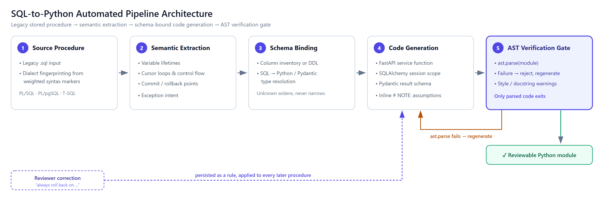

# Parse, Map, Verify: A Blueprint for Automating SQL Stored Procedure Migration to Python

> **Quick Answer**
>
> Automated stored procedure migration works by parsing legacy PL/SQL or T-SQL into a structured representation of its control flow, mapping its declared types onto Pydantic schemas, and generating a FastAPI service function that preserves the original transaction boundaries. The critical design decision is treating Python's own `ast.parse` as a hard gate rather than a post-hoc check: generated code that does not parse is rejected and regenerated before a human ever reviews it. In our migrations, this single constraint moved output from "a promising first draft" to "a reviewable artifact."

---

## Why Move Business Logic Out of SQL Stored Procedures?

Database-bound business logic is the quietest form of technical debt an enterprise carries. It runs reliably for years, which is precisely why nobody touches it.

The cost surfaces elsewhere. Logic inside a stored procedure cannot be unit tested without a live database, cannot scale independently of the database tier, and cannot be reasoned about by the application team that owns the feature.

When refactoring multi-thousand-line PL/SQL routines, we consistently find the same three blockers: cursor loops that encode iteration order as business rules, exception handlers that quietly swallow failures, and transaction boundaries that exist nowhere in the documentation. Manual rewrites stall on exactly these.

Most writing on this topic argues that the debt is bad. This article instead describes a working pipeline for extracting that logic mechanically — and, more importantly, for verifying the result.

---

## What Does an Automated SQL-to-Python Pipeline Actually Look Like?



*Figure 1 — The five-stage transformation pipeline. Only a module that survives the AST verification gate reaches a reviewer.*

The flow runs left to right in five stages. A `.sql` file is **fingerprinted for dialect** using weighted syntax markers — `%ROWTYPE`, `$$ … LANGUAGE plpgsql`, `@@ROWCOUNT` — then **semantically extracted** for variable lifetimes, cursor loops and commit points.

**Schema binding** joins that against supplied table metadata to resolve SQL types, **code generation** emits the FastAPI service function, and the **AST verification gate** parses it.

Two feedback arrows matter more than the forward path. A failed parse returns the syntax error to code generation for an automatic retry; reviewer corrections return as persistent rules that every later procedure inherits.

The verification gate is the stage most pipelines omit, and it is the one that makes the output trustworthy.

---

## Step 1: How Do You Parse Procedural SQL Logic?

Dialect detection comes first, because the same keyword means different things across vendors. We score the source against weighted markers rather than matching a single token — comments are stripped first, so a note reading "ported from T-SQL" in an Oracle file does not swing the result.

The extraction stage then has to capture three things that naive line-by-line translation loses:

- **Cursor loops as iteration contracts.** A `FOR item_rec IN c_items LOOP` is not a `for` loop over a list; it holds a server-side cursor whose ordering and locking behaviour may be load-bearing.
- **Transaction boundaries.** A single `COMMIT` at the end of a 400-line procedure means the entire body is one atomic unit. Splitting it across HTTP calls silently changes the failure semantics.
- **Exception intent.** `WHEN OTHERS THEN ROLLBACK; RAISE;` re-raises after cleanup. An `except Exception: pass` would be a faithful-looking translation and a production incident.

---

## Step 2: How Do SQL Types Map to Pydantic Schemas?

Type mapping is where fabricated precision does real damage. `NUMBER(12,2)` is a `Decimal`, not a `float`; `NUMBER(1)` is often a boolean flag, but only if the schema says so.

We drive this from supplied table metadata — an uploaded column inventory or pasted DDL. The rule we enforce is that a blank cell means *unknown*, never *permissive*.

An early version of our tooling treated an empty `nullable` column as `NOT NULL`. It generated confident, wrong constraints across every table. Absent metadata must widen the type and emit a comment, not narrow it.

Where a type genuinely cannot be resolved, the generator is instructed to choose a sensible default and mark it inline with a `# NOTE:` comment. A visible assumption is reviewable; a silent one is not.

---

## Step 3: What Does the Generated FastAPI Code Look Like?

Consider this Oracle procedure, which inserts an order, walks staged line items under a row lock, decrements stock, and commits once:

```sql
CREATE OR REPLACE PROCEDURE process_customer_order (
    p_customer_id   IN  NUMBER,
    p_order_id      OUT NUMBER
) IS
    v_total_amount  NUMBER(12,2) := 0;
    v_stock         NUMBER;
    CURSOR c_items IS
        SELECT product_id, quantity, unit_price
        FROM   order_items_staging
        WHERE  customer_id = p_customer_id;
BEGIN
    INSERT INTO orders (order_id, customer_id, order_status, order_date, total_amount)
    VALUES (orders_seq.NEXTVAL, p_customer_id, 'PENDING', SYSDATE, 0)
    RETURNING order_id INTO p_order_id;

    FOR item_rec IN c_items LOOP
        SELECT stock_quantity INTO v_stock
        FROM   products
        WHERE  product_id = item_rec.product_id
        FOR UPDATE;

        IF v_stock < item_rec.quantity THEN
            RAISE_APPLICATION_ERROR(-20001, 'Insufficient stock for product ' || item_rec.product_id);
        END IF;

        UPDATE products
        SET    stock_quantity = stock_quantity - item_rec.quantity
        WHERE  product_id = item_rec.product_id;
        ...
    END LOOP;

    COMMIT;
EXCEPTION
    WHEN OTHERS THEN
        ROLLBACK;
        RAISE;
END process_customer_order;
```

The generated service layer preserves the single commit, the row lock, and the re-raise:

```python
from decimal import Decimal
from pydantic import BaseModel
from sqlalchemy import select, update
from sqlalchemy.orm import Session


class OrderResult(BaseModel):
    """Outcome of creating an order from a customer's staged items."""

    order_id: int
    total_amount: Decimal


class InsufficientStockError(Exception):
    """Maps ORA-20001 from the source procedure."""


def process_customer_order(session: Session, customer_id: int) -> OrderResult:
    """Create an order from staged items, decrementing stock atomically.

    Side effects:
        Inserts one `orders` row and one `order_items` row per staged item,
        and decrements `products.stock_quantity`. Commits once on success;
        rolls back and re-raises on any failure.
    """
    # session.begin() reproduces the procedure's single COMMIT boundary:
    # the whole body is one transaction, committed only at the end.
    with session.begin():
        order = Order(customer_id=customer_id, order_status="PENDING",
                      total_amount=Decimal("0.00"))
        session.add(order)
        session.flush()                      # populates order.order_id

        total = Decimal("0.00")
        staged = session.scalars(
            select(StagedItem).where(StagedItem.customer_id == customer_id)
        )

        for item in staged:
            # with_for_update() preserves the source's SELECT ... FOR UPDATE;
            # dropping it would turn this into a lost-update race.
            product = session.scalars(
                select(Product)
                .where(Product.product_id == item.product_id)
                .with_for_update()
            ).one()

            if product.stock_quantity < item.quantity:
                raise InsufficientStockError(
                    f"Insufficient stock for product {item.product_id}"
                )

            product.stock_quantity -= item.quantity
            session.add(OrderItem(order_id=order.order_id,
                                  product_id=item.product_id,
                                  quantity=item.quantity,
                                  unit_price=item.unit_price))
            total += item.quantity * item.unit_price

        order.total_amount = total
        order.order_status = "CONFIRMED"

    return OrderResult(order_id=order.order_id, total_amount=total)
```

Note what is deliberately *not* here: no FastAPI route decorator. The priority is a testable service function; the transport layer is a three-line wrapper added later.

---

## What Are the Enterprise Trade-offs and Pitfalls?

**Round-trip latency replaces in-database locality.** A procedure that looped 500 times inside the database now issues 500 statements across a connection. Batch the reads, or keep genuinely set-based work in SQL.

**Transaction scope is the highest-risk translation.** Autonomous transactions, savepoints, and nested commits have no clean Python analogue. Flag them for human review rather than approximating them.

**Incremental migration creates dual-write windows.** While both the procedure and the service exist, both can mutate the same rows. Decide early which owns the write path.

**Generated code that parses is not code that is correct.** The AST gate eliminates a whole class of failure — it says nothing about business logic. Characterisation tests against the legacy procedure remain mandatory.

---

## A Five-Point Readiness Checklist for Engineering Leads

1. **Inventory and rank.** Extract every procedure with line count, call frequency, and last-modified date. Migrate the high-churn, low-complexity ones first to build confidence.
2. **Capture schema metadata before you start.** Type mapping quality is bounded by the column inventory you supply. Blank fields must widen types, not narrow them.
3. **Write characterisation tests against the legacy procedure first.** Record real inputs and outputs while the procedure still runs in production; that recording is your migration oracle.
4. **Make syntax validation a gate, not a report.** Reject and regenerate unparseable output automatically. Reviewer attention is too expensive to spend on syntax errors.
5. **Persist reviewer corrections as rules.** When an engineer corrects a translation pattern, capture it so the next procedure inherits the fix. Corrections that live only in a code review are lost.

---

## Frequently Asked Questions

**Does moving logic out of the database hurt performance?**
Usually yes for row-by-row work, and the fix is architectural rather than cosmetic. Convert cursor loops into set-based statements or batched reads instead of porting the loop shape directly; genuinely set-oriented logic should stay in SQL.

**How do you handle complex transactions and savepoints?**
Map a single trailing `COMMIT` onto one explicit context manager, which is mechanical and safe. Autonomous transactions and nested savepoints are not mechanically translatable — mark them for human decision rather than generating a plausible guess.

**How do you get test coverage for generated code?**
Treat the legacy procedure as the specification and record its behaviour against real inputs before migrating. Generated code then has to satisfy those recorded cases, which converts an unverifiable rewrite into a measurable one.

---

## The Takeaway

Automated transformation does not remove engineering judgement from stored procedure migration; it relocates it. Engineers stop hand-translating cursor loops and start reviewing transaction boundaries and type assumptions — which is where their judgement was always worth the most.

The pipeline is only as trustworthy as its verification stage. Parse the output, reject what fails, regenerate, and persist every correction a reviewer makes.
